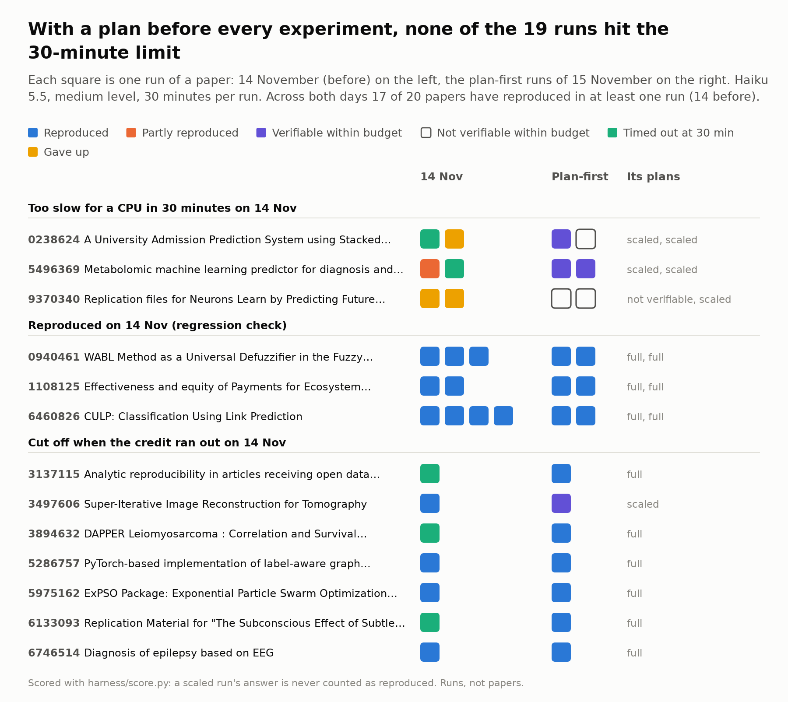

# ReproBot

**Smoke-test a research paper.** ReproBot runs a paper's code in a sandbox and tells you, in minutes, whether the published numbers come out, quoting the line of output behind every answer.

Building on someone else's paper usually starts with days of getting their code to run. ReproBot is a [LangChain Deep Agents](https://github.com/langchain-ai/deepagents) agent that does that first pass for you. Built at HackPrinceton Fall 2026 for the LangChain "Best use of deepagents" track.

## Results on 20 real papers

Measured on 20 papers from [CORE-Bench](https://arxiv.org/abs/2409.11363) (medium level, Claude Haiku 5.5, 30 minutes on a CPU per run):

- **17 of 20 papers reproduced** in at least one run.
- **No wrong exact number in 98 recorded answers.** Every answer quotes the output line it came from, and the quote is checked against the run's saved output.
- **A reproduced run takes a median of 9.3 minutes;** a run costs about 9 cents on average.
- **Papers too big for the limits are flagged, not faked.** Since the planning step, none of 19 runs hit the time limit (5 of 22 earlier runs of the same papers did). Each ends as *verifiable within budget* (a scaled-down run's projection, at most ±10% wide, contains the paper's number) or *not verifiable within budget*.

<picture><source media="(prefers-color-scheme: dark)" srcset="research/eval-2026-11-15-plan-first/images/08-plan-first-outcomes-dark.png"></picture>

Full reports: [the first two cycles](research/eval-2026-11-14/README.md) (14 November) and [the planning step on real papers](research/eval-2026-11-15-plan-first/README.md) (15 November).

## How it works

1. **Plan first.** A `scoper` subagent reads the paper and the code, flags missing steps, times a short probe of the experiment and records a plan: run in full, run a scaled-down version, or not verifiable within the budget. Experiments are refused until a plan exists.
2. **Set up in a sandbox.** Code runs in a rootless Podman container that only holds the paper's files, with skills for common setups (Code Ocean capsules, old Python pins, conda, R, notebooks) and a memory of fixes from earlier papers.
3. **A human approves each experiment.** A scaled-down run's approval lists every setting it changes.
4. **Answers need evidence.** Each answer is recorded with the exact output line it came from. The harness scores it against CORE-Bench's reference values, which the agent never sees.

Deep Agents features in use: `create_deep_agent`, five subagents (`scoper`, `paper-reader`, `env-builder`, `runner`, `result-judge`), `write_todos` planning, a `CompositeBackend` routing `/memories/` and `/skills/`, `interrupt_on` approvals, and a LangSmith trace per run. [agent/FEATURES.md](agent/FEATURES.md) shows where each one appears in a run.

## Try it

- **Without a model key:** `python3 -m harness.server`, open http://localhost:8000, pick *Toy linear regression* and choose **Demo replay**. It plays back a recorded run through the real UI, approvals included.
- **With a model:** set up [agent/](agent/README.md) (a venv and an OpenRouter key in `.env`), fetch CORE-Bench tasks with `python -m harness.corebench fetch <capsule ids>`, then start runs from the web UI or with `python -m harness.batch`. [harness/README.md](harness/README.md) lists every command, and [harness/DEMO.md](harness/DEMO.md) is the demo path.

## Limitations

- Tested at CORE-Bench's medium level (the paper's Dockerfile and instructions are kept), mostly with Claude Haiku 5.5. The hard level hasn't been tested.
- Papers that need a GPU or hours of CPU are flagged, not reproduced.
- The planning step adds about 5 minutes per run on easy papers.
- The arXiv-link mode (`python -m agent.arxiv <id>`) runs end to end but hasn't reproduced a paper yet.

## Repository

| Path | What it is |
|---|---|
| [agent/](agent/README.md) | The deep agent |
| [harness/](harness/README.md) | Task loaders, scoring, the web UI, the batch runner and the scoreboard |
| [contract/](contract/CONTRACT.md) | The file-based interface between the two |
| [research/](research/) | Evaluation reports, the build plan, and the hackathon research below |

## Hackathon research notes

HackPrinceton research.

- [research/judging-criteria.md](research/judging-criteria.md): the four official judging criteria (creativity, utility, charity, avidity). Check ideas, scope and features against these
- [research/prizes/hackprinceton-fall-26-special-tracks.md](research/prizes/hackprinceton-fall-26-special-tracks.md): Fall 2026 sponsor tracks with their own criteria and prizes (CoStar, Amazon, Peri, LangChain, Arlequin AI, Capital One, Photon, ChatOverflow, Physical AI)
- [research/SUMMARY.md](research/SUMMARY.md): dated summary of the findings, newest conclusions last (Second Key ranked #1, ShiftProof dropped)
- [research/hackathon-ideas-final.md](research/hackathon-ideas-final.md): the 15 researched and scored ideas
- [research/hackathon-ideas-round2.md](research/hackathon-ideas-round2.md): 12 new event-day ideas (brainstorm, not researched), covering Entertainment, Science & Discovery and Sustainability
- [research/hackathon-ideas-round3-deepagents.md](research/hackathon-ideas-round3-deepagents.md): best Deep Agents fit among round 2, plus 3 new researched ideas (Odyssey, Council Thread, IEP Case File)
- [research/langchain-deepagents-eval.md](research/langchain-deepagents-eval.md): LangChain deepagents track only: Repro Bot vs Second Key vs Cash Drawer, scored on the track questions + rubric; pick is Repro Bot on CORE-Bench tasks
- [research/repro-bot-build-plan.md](research/repro-bot-build-plan.md): build plan for Repro Bot (plan only, nothing built): two roles (Agent, Harness), a frozen file-based contract between them, continuous loops, MVP human-testable at T+14 h
- [research/hackprinceton-plan.md](research/hackprinceton-plan.md): build plan for a team of 3
- [research/specs/](research/specs/): specs for Second Key, Neighbor Call, ShiftProof and backups
- [research/prizes/](research/prizes/): prize lists from Fall 2025, Spring 2026 and Fall 2026 (tracks and MLH prizes; the sponsor tracks are in the special-tracks file above)
- [research/hackprinceton-winners-analysis.md](research/hackprinceton-winners-analysis.md): what past winners built
- research/hackprinceton-materials.html: everything above as one page (download and open in a browser)
