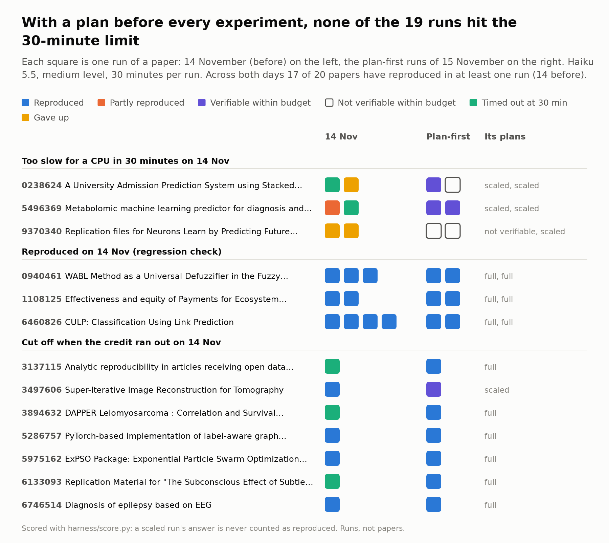
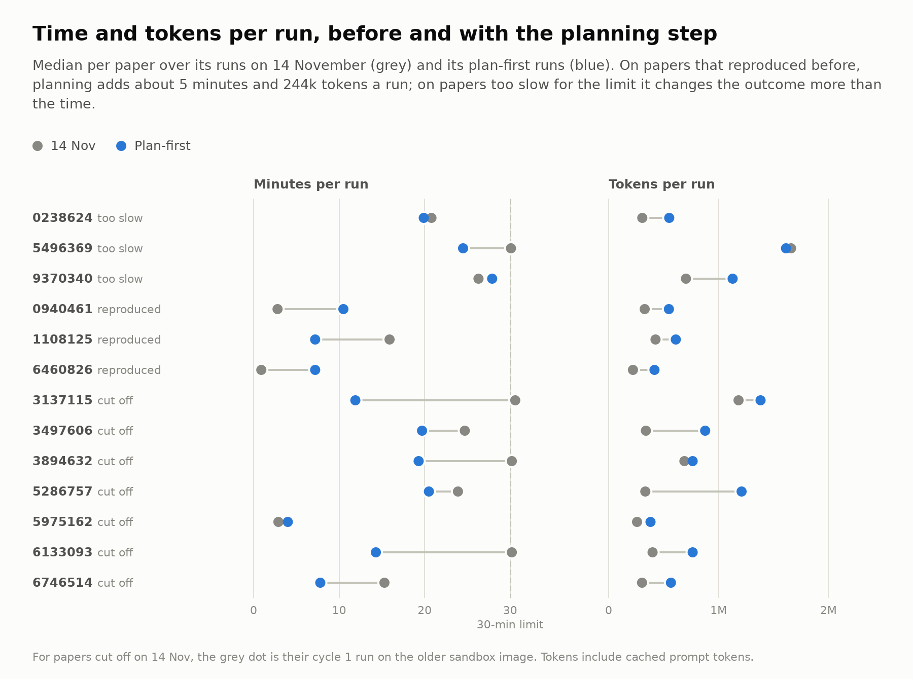

# Plan-first runs: what changed on real papers (15 November 2026)

With a plan before every experiment, none of the 19 plan-first runs hit the 30-minute limit, and **17 of 20 papers have now reproduced in at least one run** (14 before). Every run handed the task to the `scoper` subagent first and recorded its plan before any experiment; no run even tried an experiment before its plan. The price is time and tokens: on papers that reproduced before, a run now takes about 5 minutes and 244k tokens more.

Setup: commit `8b6a88a` (plan-first, see `research/` doc "Repro Bot: Plan-First Runs and Budget-Scaled Verification"), Claude Haiku 5.5 through OpenRouter, CORE-Bench medium level, 30 minutes per run, sandbox image `:2`, two batches at `--parallel 6`, 15 November from 04:08 to about 05:20 UTC. Runs from 14 November on the same papers are the "before" (`research/eval-2026-11-14/`).

<picture><source media="(prefers-color-scheme: dark)" srcset="images/08-plan-first-outcomes-dark.png"></picture>

## The numbers

| | 14 November (same papers) | Plan-first (15 November) |
|---|---|---|
| Runs | 22 | 19 on 13 papers |
| Runs that hit the 30-minute limit | 5 | 0 |
| Scoper called first / plan before any experiment | – (no planning step) | 19 of 19 / 19 of 19 |
| Plans | – | 12 full, 6 scaled, 1 not verifiable |
| Outcomes | – | 12 reproduced, 4 verifiable within budget, 3 not verifiable within budget |
| Answers | – | 47 questions: 36 exact and right, 7 projections in range, 1 projection out of range, 3 "not verifiable within budget"; no wrong exact number |
| Median per run | – | 15.1 min, 680k tokens |
| Cost | – | $1.69 for 19 runs (8.9¢ a run, $0.11 per million tokens) |

By group:

| Papers | Runs | Result | Median minutes, before → after | Median tokens, before → after |
|---|---|---|---|---|
| Too slow for a CPU on 14 Nov (0238624, 5496369, 9370340) | 6 | 3 verifiable, 3 not verifiable, 0 timeouts | 29.6 → 24.5 | 703k → 1,079k |
| Reproduced on 14 Nov (0940461, 1108125, 6460826) | 6 | 6 reproduced | 2.6 → 7.4 | 317k → 561k |
| Cut off by credit on 14 Nov (7 papers) | 7 | 6 reproduced, 1 verifiable | 24.7 → 14.3 | 339k → 764k |

The three papers that never had a full run on the fixed sandbox image (3137115, 3894632, 6133093) all reproduced. For that group the "before" is cycle 1 on the older image, so its time and token changes are not the planning step's alone.

<picture><source media="(prefers-color-scheme: dark)" srcset="images/09-plan-first-time-tokens-dark.png"></picture>

## What the scoper did on the papers that are too slow

| Paper | Plan | Scale-down | Result |
|---|---|---|---|
| 0238624, TensorFlow ensemble | scaled, full run projected 80 min | epochs 150 → 8 (convergence) | verifiable: the projection's interval held the reference |
| 0238624, second run | scaled, full run projected 57 min | epochs 150 → 30 | not verifiable: the scaled run couldn't show it; both questions say why |
| 5496369, survival forest | scaled, projected 70 and 80 min | selection rounds, permutation repeats and forest refits cut | verifiable, both runs |
| 9370340, CUDA-only spiking network | not verifiable (46 min on CPU), then scaled to a data subsample | train 60,000 → 6,000 rows | not verifiable, both runs: one honest no-answer, one projection out of range |

## Trade-offs the runs show

1. **The plan comes late.** The scoper sets up the environment and times a probe before it records the plan: median minute 8.6, worst 29.0 (9370340, with 0.9 minutes left). A late plan shrinks the time left, and the 60% rule then scales papers that would fit: 3497606 (full run projected at 12.5 minutes against an allowance of 10.8 at minute 12) came out verifiable although it reproduced in full on 14 November. Next fix: time-box the scoper (plan by about minute 8, estimating from the code when setup runs long) and measure the allowance from the time left after setup.
2. **Planning costs about 5 minutes and 244k tokens a run on easy papers** (about 3¢). Next fix: skip the probe when the code has no heavy setting.
3. **Plans vary between runs of the same paper.** 0238624 was scaled to 8 epochs once (verifiable) and to 30 epochs once (not verifiable). Remembering the last plan's timing would make them consistent.
4. **A scaled answer never counts as reproduced**, even when the asked value doesn't depend on the scaled setting (the scoper noted for 3497606 that the iteration-100 values are the same in the scaled run). Whether such answers may count is an open question for the team.
5. **Fixed after these runs:** a scaled run that ends with "not verifiable within budget" for every question was labelled `failed` (0238624, second run); it is now `completed` like a plan that says so from the start.

## Files

| Path | What it is |
|---|---|
| `images/` | Figures 8 and 9, light and dark |
| `data/runs_pf.json` | One row per run (14 November runs of the 20 papers and the 19 plan-first runs): outcome, plan, scale-down, timings, tokens |
| `data/metrics_pf.json` | Everything above, per group and per paper |
| `scripts/` | `pf_dataset.py` → `metrics_pf.py` → `render_pf.py` |

Nothing here holds expected values or anything they can be worked out from. `pf_dataset.py` scores runs through `harness/score.py`, so it reads the answer keys: whoever works on `agent/` should not run it.
